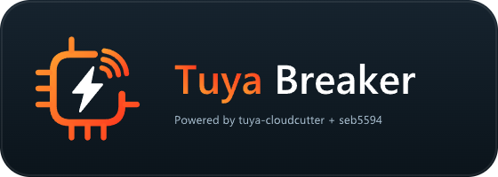
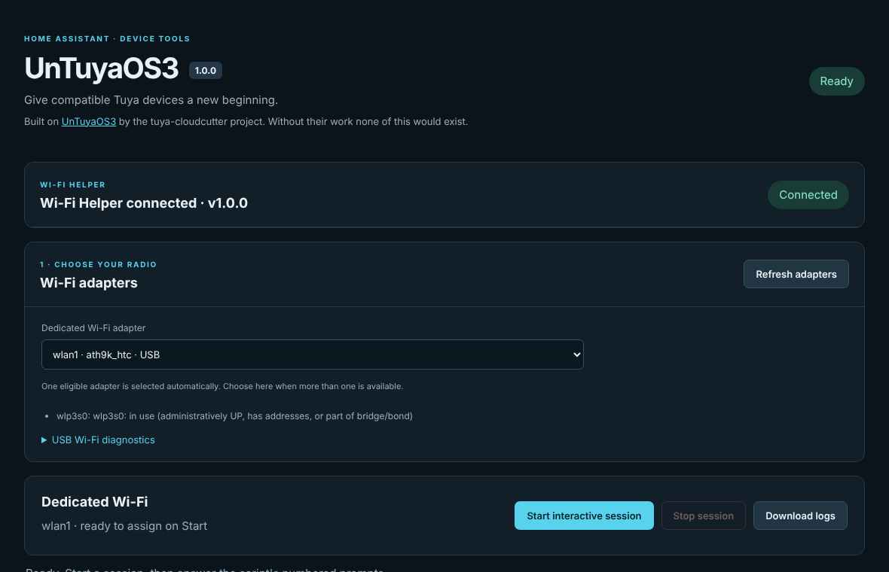

<!-- header:begin (generated from project metadata) -->
<h1 align="center">UnTuyaOS3</h1>

  

---

  
   
  
  
   
  
  
  
  
   
  
  
  
  

<!-- header:end -->

**English** · [Deutsch](README.de.md)

> [!CAUTION]
> ## Flashing can brick your device. You do this at your own risk.
>
> A finished transfer, a valid image or a happy-looking log line does **not** promise that the device boots afterwards. An interrupted upload, the wrong image or a firmware version the exploit does not suit can leave you with a dead device, or one you can only revive with a soldering iron and a serial adapter.
>
> - Only flash devices you can afford to lose.
> - Read the [compatibility list](docs/compatibility.md) and upstream's [FAQ](https://github.com/tuya-cloudcutter/UnTuyaOS3/wiki/FAQ) first.
> - Keep the device powered and the signal strong until the very end. Do not pull the plug during an upload.
> - There is no warranty (see the MIT license) and no guarantee for a successful flash or for recovery.
>
> One of my own lamps went dark after a flash. It was running Kickstart, but I only found out because I went looking for its Wi-Fi. [The full story](docs/table-lamp-3225458.md) is worth reading before you start.

## What is this?

This repository is now **Home Assistant Anti Tuya Apps**. The [main app catalog](https://github.com/seb5594/Home-Assistant-Apps) lists all three apps individually:

| App | Purpose | Setup |
| --- | --- | --- |
| Tuya Breaker (Experimental) | Combined tool workspace, hardware explorer and firmware library | [README](tuya_breaker/README.md) · [Guide](tuya_breaker/DOCS.md) |
| UnTuyaOS3 | Original interactive UnTuyaOS3 workflow | [README](untuyaos3/README.md) · [Guide](untuyaos3/DOCS.md) |
| Anti Tuya WiFi Helper | Shared adapter isolation and restoration for either main app | [README](untuyaos3_wifi/README.md) · [Guide](untuyaos3_wifi/DOCS.md) |

Install the helper once and choose either main app; use only one main app at a time. The helper keeps its existing installed identifier, pairing configuration and recovery data after the display-name change.

**New on `dev`: [Tuya Breaker](tuya_breaker/DOCS.md), an experimental combined app with UnTuyaOS3 and classic Tuya CloudCutter in one Ingress workspace.** It lives in `tuya_breaker/` and shares the existing Wi-Fi Helper. The original UnTuyaOS3 app remains available. This integration has software/container tests but no physical-device CloudCutter validation yet. Lightleak is out of scope for now.

Its device explorer reads the [OpenBeken device database](https://openbekeniot.github.io/webapp/devicesList.html) programmatically, with search, chip/module filters, cached hardware references and source links. Thanks to **OpenBeken / openshwprojects**, the **Elektroda.com teardown community** and **tuya-cloudcutter** for their work. Hardware entries do not establish exploit compatibility; an exact CloudCutter firmware profile is still required.

A lot of cheap smart-home gadgets (the LSC lamps, LED strips and power strips from Action, for example) only talk to the Tuya cloud. [UnTuyaOS3](https://github.com/tuya-cloudcutter/UnTuyaOS3) can put open firmware on **some** of them over Wi-Fi, without opening the case, as long as their firmware is affected by the exploit.

Normally you need a Linux machine, a Wi-Fi adapter and a stack of scripts. This app puts all of it inside Home Assistant. You pick a spare Wi-Fi adapter in the web UI, press start and answer the script's numbered menu. The console, the live logs and a firmware library are right there in the sidebar. The adapter is taken away from the host for the duration of the session and handed back afterwards, so your network stays as it was.

I build things like this in my spare time because I like my gadgets cloud-free. The project works well on my own hardware, which is why it is now 1.0. That means *the software is done*, not that *your device will work*.

> **Credit where it is due.** The exploit, the protocol work, the scripts and the bundled firmware come from the [tuya-cloudcutter](https://github.com/tuya-cloudcutter) community. UnTuyaOS3 is their project, and the original exploit was found by [kuba2k2](https://github.com/kuba2k2) of [LibreTiny](https://github.com/libretiny-eu/libretiny). All I did is wrap it for Home Assistant: web UI, isolated Wi-Fi handling, logs, uploads. Without their work none of this would exist, so please go and star their repository.

## What has worked so far

These are my own devices, each with one firmware version. Details and the Wi-Fi adapters are in the [compatibility list](docs/compatibility.md).

| Device | Original firmware | Result |
| --- | --- | --- |
| LSC Smart Floor Lamp (T1) | 1.2.1 | **Worked.** The log shows the device's OTA-finish response. |
| LSC Smart Connect table lamp (Action 3225458) | 1.0.43 | **Partly.** Kickstart is running, but the lamp's outputs are not set up yet. |
| LSC Smart LED Strip Kit (Action 3225770) | 1.0.28 | **Exploit accepted.** What came after that is not documented. |
| Battletron Lightbar (2024) | unknown | **Not accepted.** The device answered `0x0C`, so the app stopped before the next stage. |

A flash has several stages that can each go wrong: exploit accepted, transfer complete, device confirms, new firmware boots, outputs work. The list keeps them apart. Kickstart is only a generic setup firmware, it does not know your lamp's pins until you configure it.

## Ready-made firmware for Action devices

Flashing is only half the job: afterwards the device needs a firmware that knows its pins. For devices sold by the discounter Action (brands LSC Smart, Battletron and Eurodomest) I have built a [collection of prebuilt ESPHome firmware](https://gitea.seb5594.xyz/seb5594/Action_Battleton_Eurodomest_LSC-Smart-Custom-Firmware-Collection) and put it on my own Gitea. Download the image for your device there, upload it as a UG image in the Web UI's firmware library and flash it. It is only for devices from Action. Same warning as always: check that the device and firmware version match, and expect to risk the device.

## What you need

- Home Assistant OS (or a Supervised install) on **amd64 or aarch64**.
- Home Assistant connected over **Ethernet**. The adapter used for flashing is borrowed from the host for a while, so it must not be the one HA itself relies on.
- A spare **Wi-Fi adapter with AP mode**. A USB stick is the easiest choice. The one I use is an Atheros AR9271 (`0cf3:9271`).
- A device you want to flash, within reach, and patience.

### Which Wi-Fi adapters might work?

The app can only use what the HAOS kernel ships. These are the Wi-Fi drivers HAOS builds for USB and SDIO (checked 28 October 2026, kernel 6.18):

| Family | Drivers |
| --- | --- |
| Atheros | `ath9k_htc`, `carl9170`, `ath6kl_usb`, `ath10k_usb` |
| MediaTek | `mt7601u`, `mt76x0u`, `mt76x2u`, `mt7663u`, `mt7921u` |
| Ralink | `rt2500usb`, `rt73usb`, `rt2800usb` |
| Realtek | `rtl8xxxu`, `rtl8192cu`, `rtw88_8822bu`, `rtw88_8822cu`, `rtw88_8723du` |
| Broadcom, Marvell | `brcmfmac` (USB), `mwifiex` (USB) |

Built-in PCIe Wi-Fi is covered too (Intel `iwlwifi`, Atheros, MediaTek, Realtek, ...). Listed does **not** mean tested. So far only the AR9271 has flashed anything; the internal Realtek RTL8822CE connects, but its signal was often too weak. AP mode and the namespace handover depend on the driver, and the app checks both before it touches anything. The whole list with typical chips is in [docs/wifi-compatibility.md](docs/wifi-compatibility.md). Your adapter is not on the tested list? Please [report it](#help-grow-the-compatibility-list).

## Install

1. In Home Assistant open **Settings → Apps → App store**, then **⋮ → Repositories** and add `https://github.com/seb5594/Home-Assistant-Anti-Tuya-Apps`. (Older versions call these *Add-ons*.)
2. Install **both** apps: **UnTuyaOS3** and **Anti Tuya WiFi Helper**. They are two apps on purpose, [here is why](docs/architecture.md#why-two-apps).
3. Pick a pairing secret of at least 32 characters and enter the same one in the **Configuration** tab of both apps. Do not have a good one at hand? Open the main app's Web UI first, press **Generate pairing secret** and paste the result into both.
4. Keep **Protection mode** and AppArmor switched on. Start the helper, wait for *Ready* in its log, then start the main app and press **Open Web UI**.

The Web UI starts with a *Wi-Fi Helper* card that tells you what is missing: helper not running, secrets that differ, versions that do not match. It notices the helper as soon as it starts, so the order is not critical. After you plug in a USB adapter, press **Refresh adapters**.

Both apps start manually, on purpose. Please do not add a watchdog that restarts them while a flash is running. Update both apps together.

## Flashing a device

1. Put the device into AP pairing mode. Usually that means a slow blink.
2. Press **Start interactive session** in the Web UI.
3. Answer the script's numbered questions (platform and firmware) in the **Menu choice** box.
4. Watch the console and the activity panel. Verbose logging is on, so you see every frame.
5. When it ends, check the result and **test the device**. Exit status 0 is no independent proof that the new firmware runs.
6. Stop the main app when you are done. The helper restores the adapter and stays ready.

Closing the browser does not cancel the session. When you come back the recent output is replayed. **Stop session** interrupts the script, and interrupting an upload can brick a device.

*Unconfirmed* means every byte went out but the device never said it was done. Look for a Kickstart Wi-Fi network before you try anything else.

## When something does not work

- **No adapter in the list.** The reason is printed under the dropdown. Typical ones: it is connected, in use, blocked, or has no AP mode.
- **USB stick on the bus but no interface.** The host driver or its firmware is missing. Plug it straight into the machine, press *Refresh adapters*, check Home Assistant's host log for `ath9k_htc` or firmware errors. The apps cannot install drivers.
- **Signal around −90 dBm or worse.** Too weak, even right next to the lamp. Check the antenna, restart pairing mode or try another adapter.
- **Device answers `0x0C` instead of `0x16`.** Wi-Fi and DHCP are fine, but this firmware does not speak the expected protocol. The app stops on purpose. Check the firmware version against upstream's [compatibility wiki](https://github.com/tuya-cloudcutter/UnTuyaOS3/wiki/Device-Compatibility).
- **Anything else.** Read the *Log* tab of both apps, and have a look at [how it works](docs/how-it-works.md).

## Help grow the compatibility list

Which devices, chips and adapters work is only known because people try them. If you flashed (or failed to flash) something, tell me. The **Report a device** button at the bottom of the Web UI opens a form with your app version and adapter already filled in. You can also [open the form directly](https://github.com/seb5594/Home-Assistant-Anti-Tuya-Apps/issues/new?template=device-report.yml). Failures are as useful as successes. Please leave keys, UUIDs and device IDs out, the issue is public.

## Security in short

The main app, with the web UI and the upstream scripts, runs in an isolated network namespace and only sees the one radio it was given. The helper is the only part on the host network. It has no web server and exists to move radios in and out. Both talk over a local socket after proving they share the secret. Nothing here has access to your Home Assistant configuration, the Docker socket or the Supervisor API. The details, including what the helper still can do, are in [docs/architecture.md](docs/architecture.md). Do not disable AppArmor.

## Staying current with upstream

Pinned upstream revision: [`2111458`](https://github.com/tuya-cloudcutter/UnTuyaOS3/commit/2111458225c269ddddf5353bf09a1e8f1096d959), which is upstream's release v1.0.1. A workflow checks every day whether UnTuyaOS3 published something newer and opens a pull request against `dev`. Nothing is published until I have read the diff and tested it.

## More documentation

- [How it works](docs/how-it-works.md): adapter checks, Wi-Fi connection, firmware library, logs and recovery
- [Architecture](docs/architecture.md): why two apps, permissions, source layout
- [Wi-Fi adapters on HAOS](docs/wifi-compatibility.md): drivers and what was tested
- [Compatibility list](docs/compatibility.md)
- [Table lamp incident](docs/table-lamp-3225458.md)
- [Contributing](CONTRIBUTING.md)

Not an official Home Assistant or Tuya product. Tuya is a trademark of its owner; the icon and logo here are my own artwork, only the orange is a nod to the brand. Upstream software and firmware keep their own licenses.

<!-- support:begin (generated, shared text) -->
## Say thanks

All my projects are built in my spare time, just for the fun of it. Still, they take a lot of time and care, and many of the smart home gadgets I buy end up here because I want to make them cloud-free and smart-home ready. Every bit of support means a lot to me.

If my work helped you or turned out to be useful, show your appreciation with a hot drink for my next sleepless night.

 
<!-- support:end -->

<!-- license:begin (generated from the license file) -->
## License

Published under the [MIT License](LICENSE).
<!-- license:end -->
